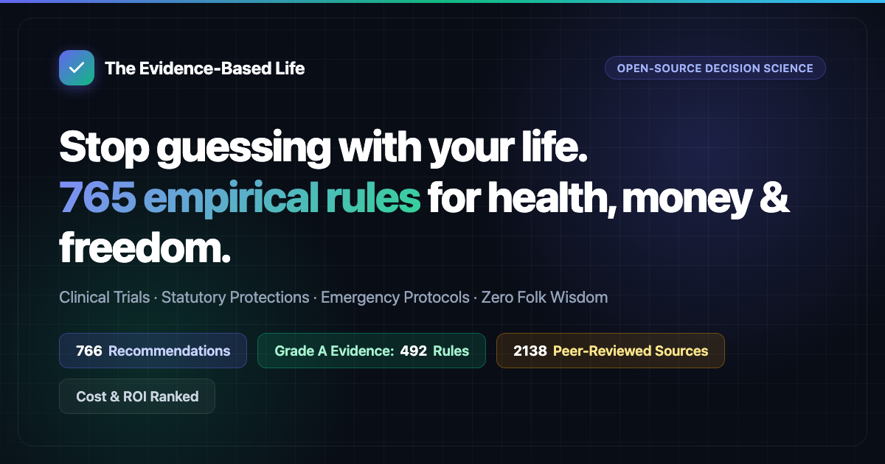

<div align="center">

<a href="https://changchunlei.github.io/The-Evidence-Based-Life/">
  
</a>

# The Evidence-Based Life

**Stop guessing with your life. 766 recommendations for health, money, legal boundaries, and emergency survival — being localised for Australian readers.**

*Every rule specifies the exact costs incurred (money, time, willpower), the measured return on investment, and primary citations from peer-reviewed clinical trials and statutory law. Zero folk wisdom. Zero marketing hype.*

> [!NOTE]
> 🇦🇺 **Australian edition — localisation in progress.** Emergency numbers and crisis hotlines have been checked across all 34 chapters, and Chapter 1 has been fully localised. Many rules in other chapters still describe the Chinese laws, institutions, and amounts of the original edition. Check the [localisation report](docs/verification-records/australian-localisation-report.md) for coverage, and confirm legal and benefit rules with the relevant Australian agency before acting on them. International clinical evidence keeps its original study populations. **In an emergency call 000; Lifeline (13 11 14) provides 24-hour crisis support.**

[](https://github.com/changchunlei/The-Evidence-Based-Life)
[](https://github.com/changchunlei/The-Evidence-Based-Life/actions/workflows/book.yml)
[](https://changchunlei.github.io/The-Evidence-Based-Life/)
[](#-complete-chapters)
[](#evidence-grading-standard)
[](docs/verification-records/)
[](#-license--attribution)

<p align="center">
  <a href="https://changchunlei.github.io/The-Evidence-Based-Life/"><b>🚀 Interactive Web App</b></a> &nbsp;•&nbsp;
  <a href="https://changchunlei.github.io/The-Evidence-Based-Life/selfcheck.html"><b>📝 2-Min Self-Audit</b></a> &nbsp;•&nbsp;
  <a href="https://github.com/changchunlei/The-Evidence-Based-Life/releases/download/epub-latest/The-Evidence-Based-Life.pdf"><b>📥 Download PDF</b></a> &nbsp;•&nbsp;
  <a href="https://github.com/changchunlei/The-Evidence-Based-Life/releases/download/epub-latest/The-Evidence-Based-Life.epub"><b>📱 EPUB</b></a> &nbsp;•&nbsp;
  <a href="https://github.com/changchunlei/The-Evidence-Based-Life/releases/download/epub-latest/The-Evidence-Based-Life.html"><b>💾 Single-File HTML (Offline)</b></a> &nbsp;•&nbsp;
  <a href="skills/life-decision-guide/README.md"><b>🤖 AI Decision Skill</b></a>
</p>

</div>

> [!TIP]
> ⭐ **Find this guide useful?** Star this repository in the upper-right corner! Every star helps more people make life decisions based on empirical science rather than hearsay.

---

## ⚡ Did You Know? (Empirical Facts Backed by Science)

Most popular advice is either outdated folk belief or commercial advertising. Here are a few counter-intuitive realities verified across clinical trials and official records:

- 🚗 **A sedating cold medicine impaired driving more than alcohol**: In a driving-simulator trial, drivers given diphenhydramine (a sedating antihistamine found in some allergy and cold medicines) had worse vehicle control than drivers at 0.10% blood alcohol. Their own sense of drowsiness did not predict how badly they drove. ([Ch 34, Rule 12](book/34-safe-home-medication.md#12-do-not-drive-work-at-heights-or-operate-machinery-while-taking-cold-or-allergy-medications-containing-chlorpheniramine-or-diphenhydramine))
- 🛁 **Hot baths & saunas after drinking can be fatal**: About half of all sauna-related deaths in Finland involved alcohol, and in a Tokyo forensic series intoxication was the most common trigger of bathtub drowning. Never let a drunk companion bathe or use a sauna alone. ([Ch 22, Rule 11](book/22-science-backed-relaxation.md#11-do-not-use-hot-springs-saunas-or-hot-baths-after-drinking-alcohol))
- 🧂 **A cheap salt swap cut deaths by 12%**: In a randomized trial of 20,995 stroke survivors and adults over 60 with high blood pressure, switching to potassium-enriched salt lowered stroke by 14% and death by 12% over about five years — for a dollar or two more per bag. ([Ch 02, Rule 9](book/02-preventing-chronic-decline.md#9-switch-household-salt-to-lowsodium-potassiumrich-salt))
- 👶 **Baby walkers do not teach walking**: Wheeled infant walkers were linked to an estimated 230,000 US emergency department visits from 1990 to 2014, mostly head and neck injuries from falling down stairs. Walker users also learned to walk about 3 weeks later on average. Canada has banned their sale since 2004. ([Ch 20, Rule 15](book/20-newborn-survival-guide.md#15-do-not-buy-wheeled-infant-walkers-replace-them-with-stationary-activity-centers-without-wheels-or-playpens))
- 🏦 **After a scam, call your bank before anything else**: The short period right after a transfer is the only window in which your bank can flag the receiving account and attempt a recall. Once the money is spread across accounts, it is almost never recovered. Report to ReportCyber and Scamwatch (1300 795 995) afterwards. ([Ch 08, Rule 2](book/08-staying-out-of-trouble.md#2-if-you-realize-youve-been-scammed-call-your-bank-right-away-to-request-a-stoppayment--dont-try-to-investigate-on-your-own-first))
- 💬 **Asking about suicide does not plant the idea**: In a randomized trial of 2,342 high-school students, being asked directly about suicidal thoughts caused no rise in distress or suicidal thinking. Students who were already depressed reported less distress. ([Ch 01, Rule 43](book/01-avoiding-premature-death.md#43-ask-someone-who-seems-emotionally-distressed-directly-have-you-had-thoughts-of-suicideasking-will-not-plant-the-idea-or-increase-suicidal-risk))
- 💊 **The supplement illusion**: In large randomized trials, multivitamins and regular fish oil capsules did not reduce heart disease or all-cause mortality. A Cochrane review of 78 trials found that antioxidant supplements (beta-carotene, vitamin E) slightly raised mortality in the higher-quality trials. ([Ch 06, Rules 1–4](book/06-the-anti-checklist.md))
- 💳 **Lending your bank account can be a crime**: Even with zero profit for you, letting others receive or move money through your account can amount to dealing with criminal proceeds — with serious criminal liability. ([Ch 09, Rule 5](book/09-everyday-legal-traps.md#5-part-time-jobs-that-ask-you-to-use-your-own-card-to-receive-payments-withdraw-cash-or-transfer-money--no-matter-how-much-extra-pay-they-offer-avoid-them))

---

## 🎯 Quick Lookup by Real-Life Situation

Jump straight to the rules you need right now:

| Scenario | What You Will Learn | Recommended Chapters |
| :--- | :--- | :--- |
| **🚨 Emergency & Life-Threatening Situations** | Immediate first-minute response for cardiac arrest (CPR/AED), stroke, choking, severe bleeding, burns, poisoning, and home emergency supply checklists. | [Ch 13: Handling Emergencies](book/13-handling-emergencies.md)<br>[Ch 01: Avoiding Premature Death](book/01-avoiding-premature-death.md)<br>[Home Kit Checklist](docs/home-emergency-kit-checklist.md) |
| **💼 Job, Wages & Workplace Rights** | Overtime pay rates, paid annual leave, severance and notice pay, why not to sign a "voluntary resignation", work-injury claims, and reporting unpaid wages to the Fair Work Ombudsman. Many Chapter 19 rules still describe Chinese labour law. | [Ch 19: Workplace Rights](book/19-workplace-rights-and-injuries.md)<br>[Ch 07: Surviving Broke](book/07-surviving-broke.md) |
| **🏠 Renting, Landlords & Housing** | Getting your deposit back, illegal eviction defenses (lockouts and utility shutoffs), lease continuity when the property sells, and title and mortgage checks before buying. | [Ch 15: Renting and Buying a Home](book/15-renting-and-buying-a-home.md) |
| **💊 Medications, Doctors & Healthcare** | Safe cold and fever drugs, pediatric contraindications, dangerous drug combos, emergency treatment before payment, and auditing inpatient medical bills. | [Ch 34: Safe Home Medication](book/34-safe-home-medication.md)<br>[Ch 24: Navigating Healthcare](book/24-navigating-healthcare.md)<br>[Ch 16: Chronic Illness](book/16-managing-chronic-illness.md) |
| **⚖️ Law, Scams & Digital Boundaries** | Handling traffic collisions, deepfake audio/video scams, bank card fraud, developer scraping legal boundaries, and responses to false accusations. | [Ch 08: Staying Out of Trouble](book/08-staying-out-of-trouble.md)<br>[Ch 09: Everyday Legal Traps](book/09-everyday-legal-traps.md)<br>[Ch 11: Developer Legal Limits](book/11-legal-boundaries-for-developers.md) |
| **👶 Family, Parenting & Aging Parents** | Infant safe sleep (SIDS prevention) and newborn fever red flags, the true time/money cost of raising kids, school-age health, and adult guardianship & asset protection for aging parents. | [Ch 20: Newborn Survival](book/20-newborn-survival-guide.md)<br>[Ch 18: Raising Kids](book/18-the-true-cost-of-raising-kids.md)<br>[Ch 30: School-Age Kids](book/30-raising-school-age-kids.md)<br>[Ch 17: Aging Parents](book/17-caring-for-aging-parents.md) |
| **💰 Personal Finance & Scam Prevention** | High-fee fund traps, compound debt escape, insurance selection, lottery math, and escaping financial desperation during unemployment. | [Ch 05: Cutting Financial Waste](book/05-cutting-financial-waste.md)<br>[Ch 06: The Anti-Checklist](book/06-the-anti-checklist.md)<br>[Ch 07: Surviving Broke](book/07-surviving-broke.md) |
| **🧠 Productivity, Energy & Habits** | Interruption and task-switching costs, circadian rhythm repair, deep procrastination protocols, evidence-based learning strategies, and cutting zero-ROI time wasters. | [Ch 03: Protecting Mental Energy](book/03-protecting-your-mental-energy.md)<br>[Ch 04: Stopping Time Wasters](book/04-stopping-time-wasters.md)<br>[Ch 23: High-Leverage Skills](book/23-high-leverage-skills-to-learn.md) |

---

## 📖 How to Use This Guide

- **You don't need to do everything**: This is a ranked catalog of high-ROI options, not an onerous task list. Adopting even one or two rules provides immediate, compounding benefits; leave the rest and return when circumstances warrant. It is completely natural that implementing these rules is harder than reading them—the author has not mastered most of them either.
- **Start with Maximum ROI**: If you want the biggest payoff with minimal effort, prioritize the **ROI: Very High** rules. These require virtually $0, negligible time, and zero willpower while protecting life or money.
- **Search & Filter Online**: Open the [Interactive Web Reader](https://changchunlei.github.io/The-Evidence-Based-Life/) to search keywords, filter by Grade A evidence, or sort rules by cost (money, time, willpower).
- **Ask AI Directly**: Install our open-source agent skill ([skills/life-decision-guide](skills/life-decision-guide/README.md)) into Claude Code, Codex, or compatible LLMs. Ask real-world questions like *"Should I co-sign a loan for a friend?"* or *"What should I do if my landlord cuts my electricity?"* and receive sourced answers citing exact chapter and rule numbers.
- **Take It Offline**: Download the [Offline Single-File HTML](https://github.com/changchunlei/The-Evidence-Based-Life/releases/download/epub-latest/The-Evidence-Based-Life.html) for a self-contained, double-clickable offline manual that works on any laptop or phone without internet. E-reader users can grab the [EPUB](https://github.com/changchunlei/The-Evidence-Based-Life/releases/download/epub-latest/The-Evidence-Based-Life.epub) or [PDF](https://github.com/changchunlei/The-Evidence-Based-Life/releases/download/epub-latest/The-Evidence-Based-Life.pdf).

### Anatomy of an Evidence-Based Rule

Every rule follows the same verifiable template. This example is Chapter 2, Rule 9, shortened where marked with "…":

```markdown
### 9. Switch household salt to low‑sodium (potassium‑rich) salt
<!-- Cost Tag: Money=Low Time=Low Willpower=No Benefit=Med Metric=Mortality -->
- Cost: One bag costs a dollar or two more than regular salt. It’s easy to switch when you shop, adding virtually no extra time. The taste stays almost the same.
- In plain terms: For people who have had a stroke or are over 60 with hypertension, switching to low‑sodium salt can lower their chance of dying within five years by about 12% and the risk of another stroke by roughly 14%.
- Benefit: A randomized trial conducted in rural China enrolled 20,995 participants — all stroke survivors or adults aged 60+ with hypertension — and followed them for 4.74 years. Those using low‑sodium salt had a 12% lower risk of death (RR 0.88), a 14% lower risk of stroke (RR 0.86), and a 13% lower risk of major cardiovascular events (RR 0.87) compared with the regular‑salt group. …
- Evidence grade: A
- Sources: Neal B et al. (2021). Effect of Salt Substitution on Cardiovascular Events and Death. NEJM. <https://doi.org/10.1056/NEJMoa2105675>; …
- Notes: This finding is somewhat controversial. …
```

---

## 📚 Complete Chapters

The manual is divided into 34 modular chapters under [`book/`](book/), grouped below by theme and labelled with their chapter numbers. You can read them directly here on GitHub or through the [Interactive Web Reader](https://changchunlei.github.io/The-Evidence-Based-Life/). Chapters marked *localisation pending* still describe Chinese law in most rules.

### Part I: Health, Longevity & Emergencies

- **1.** [Avoiding Premature Death](book/01-avoiding-premature-death.md) — Seatbelts, helmets, carbon monoxide alarms, gas safety, edible mushroom hazards, cancer screenings, and the temporal window of suicidal ideation.
- **2.** [Preventing Chronic Decline](book/02-preventing-chronic-decline.md) — Evidence-based nutrition, potassium salt, exercise thresholds, sleep duration and naps, sedentary reduction, and smoking cessation. *(Essay: [Circadian Rhythms and Night Shifts](docs/circadian-rhythms-and-night-shifts.md))*
- **13.** [Handling Emergencies](book/13-handling-emergencies.md) — First 60-second protocols for cardiac arrest (CPR/AED), stroke, heart attack, heavy bleeding, choking, animal bites, and burns. *(Essays: [Home Emergency Kit](docs/home-emergency-kit-checklist.md) · [Stopping for Strangers](docs/should-you-stop-for-strangers-in-an-emergency.md))*
- **16.** [Managing Chronic Illness](book/16-managing-chronic-illness.md) — Long-term medication adherence, keeping one record of measurements, complication screening (eyes, feet, kidneys), and 12-week community-clinic prescriptions.
- **20.** [Newborn Survival Guide](book/20-newborn-survival-guide.md) — SIDS prevention, safe sleep environments, free national-schedule vaccines, formula guidelines, and why to avoid wheeled infant walkers.
- **24.** [Navigating Healthcare](book/24-navigating-healthcare.md) — Primary-clinic-first referrals, reimbursement differences by hospital level, emergency care before payment, itemised inpatient bill checks, and copies of your medical records. *(Localisation pending.)*
- **27.** [Pregnancy and Childbirth](book/27-pregnancy-and-childbirth.md) — Periconceptional folate, prenatal screening schedules, gestational diabetes protocols, emergency labor signals, and epidural safety.
- **28.** [Appearance vs. Health](book/28-appearance-vs-health.md) — Severe caloric restriction risks, eating disorders, cosmetic clinic licensing verification, and facial filler vascular hazards.
- **30.** [Raising School-Age Kids](book/30-raising-school-age-kids.md) — Acute pediatric red flags, anti-bullying protocols, 2-hour daily outdoor light for myopia prevention, and adolescent depression screening.
- **33.** [Navigating Life with Disability](book/33-navigating-life-with-disability.md) — Autonomic dysreflexia emergencies, pressure-relief seating, statutory employment quotas, and accessible transit rights.
- **34.** [Safe Home Medication](book/34-safe-home-medication.md) — Preventing acetaminophen liver toxicity, pediatric cold medicine bans, NSAID ulcer risks, and antibiotic stewardship.

### Part II: Money, Housing & Survival

- **5.** [Cutting Financial Waste](book/05-cutting-financial-waste.md) — Fund expense ratios, compound consumer debt traps, auto insurance fine print, recurring subscription audits, and gemstone investment scams.
- **6.** [The Anti-Checklist](book/06-the-anti-checklist.md) — Things you should stop wasting money on: multivitamins, regular fish oil, glucosamine, detox products, and generic checkup packages.
- **7.** [Surviving Broke](book/07-surviving-broke.md) — JobSeeker claims, emergency hardship relief and crisis shelters, low-cost healthcare access, public rental housing, reporting underpaid wages to the Fair Work Ombudsman, and job-scam avoidance. *(Localisation pending.)*
- **12.** [Starting and Running a Business](book/12-starting-and-running-a-business.md) — Capitalization pitfalls, personal loan guarantees, tax compliance, employment obligations, and legal exit strategies.
- **15.** [Renting and Buying a Home](book/15-renting-and-buying-a-home.md) — Deposit terms and refunds, illegal eviction defenses, lease continuity after a sale, title and mortgage checks before buying, and trust-account deposits for off-the-plan purchases. *(Localisation pending.)*
- **18.** [The True Cost of Raising Kids](book/18-the-true-cost-of-raising-kids.md) — Multi-year capital and time balance sheets, Family Tax Benefit and newborn payments, and maternity leave and pregnancy job protections (still described under Chinese law).
- **25.** [Handling End-of-Life Affairs](book/25-handling-end-of-life-affairs.md) — Death certificates and registration, autopsy deadlines in disputed deaths, regulated funeral pricing, claiming provident fund and pension balances, and heirs' limited liability for debts. *(Localisation pending.)*

### Part III: Law, Digital Safety & Career Rights

- **8.** [Staying Out of Trouble](book/08-staying-out-of-trouble.md) — Traffic collision protocols, emergency bank card freeze lines, deepfake video and voice impersonation checks, and responses to false accusations.
- **9.** [Everyday Legal Traps](book/09-everyday-legal-traps.md) — Bank card lending liability, online rumors and insults to heroes and martyrs, secret filming, illegal drone flights, and criminal part-time traps.
- **11.** [Legal Boundaries for Developers](book/11-legal-boundaries-for-developers.md) — Web scraping legal thresholds, GPL open-source license compliance, non-compete compensation rules, and ICP filing and log-retention requirements.
- **14.** [Digital Security and Privacy](book/14-digital-security-and-privacy.md) — Two-factor authentication, SIM card PINs, lost phone triage checklists, bank liability for unauthorized card transactions, unlinking accounts before changing phone numbers, and buying AI services only through official channels.
- **19.** [Workplace Rights and Injuries](book/19-workplace-rights-and-injuries.md) — Overtime pay rates, paid annual leave, probation limits, severance and notice pay, work-injury certification and death benefits, and workplace bullying. *(Localisation pending.)*
- **26.** [Building a Compliant Platform](book/26-building-a-compliant-platform.md) — Payment processing boundaries, privacy and data compliance, minor protection standards, and consumer law obligations. *(Essay: [Licensing Guide](docs/platform-compliance-and-licensing.md))*

### Part IV: Productivity, Mind & Life Trajectories

- **3.** [Protecting Your Mental Energy](book/03-protecting-your-mental-energy.md) — Context switching penalties, fixed sleep and wake times, boundary setting, and handling bureaucratic friction.
- **4.** [Stopping Time Wasters](book/04-stopping-time-wasters.md) — Sunk cost fallacies, self-help procrastination programs, meeting reduction, and commute optimization.
- **10.** [The Economics of Dating and Marriage](book/10-the-economics-of-dating-and-marriage.md) — Partner selection frameworks, pre-marital health checks, joint debt liability, and divorce exit costs. *(Essay: [Is Marriage Worth It?](docs/is-marriage-financially-worth-it.md))*
- **17.** [Caring for Aging Parents](book/17-caring-for-aging-parents.md) — Adult legal guardianship, estate planning, preventing retirement fraud schemes, and bedridden pressure ulcer prevention.
- **21.** [International Travel Safety](book/21-international-travel-safety.md) — Travel advisory tiers, consular assistance limits, overseas medical insurance, and emergency passport replacement.
- **22.** [Science-Backed Relaxation](book/22-science-backed-relaxation.md) — Autonomic down-regulation protocols (cyclic sighing, exercise for low mood, mindfulness, green space) and venue safety egress.
- **23.** [High-Leverage Skills to Learn](book/23-high-leverage-skills-to-learn.md) — Credential verification, automation-resilient skills, and cognitive learning techniques (retrieval spacing, interleaving).
- **29.** [Recovering from Major Life Blows](book/29-recovering-from-major-life-blows.md) — Acute bereavement cardiac risk windows, sudden job loss triage, trauma psychological care, and crisis helplines.
- **31.** [Life Paths After Eighteen](book/31-life-paths-after-eighteen.md) — Statutory adult pathways: military enlistment, public service and grassroots programs, self-study and adult-education degrees, remote cross-border freelancing, and gig injury coverage.
- **32.** [Studying Abroad Pragmatically](book/32-studying-abroad-pragmatically.md) — Academic accreditation checks, visa maintenance, lawful work-hour ceilings, and degree equivalence verification.

---

## 📊 Evidence Grading & ROI System

### Evidence Grading Standard

Every recommendation is classified by the rigor of its underlying source:

| Grade | Scientific Standard |
| :---: | :--- |
| **A** | Quantified outcomes from comprehensive meta-analyses, large-scale multi-year prospective cohorts, or randomized controlled trials (RCTs) with concrete effect sizes. |
| **B** | Supported by peer-reviewed literature, but based on smaller cohorts, observational associations, or lacking multi-center replication. |
| **C** | Authoritative statutory frameworks, government agency consensus, or clinical heuristics without direct epidemiological trials. |

Across all 766 rules: Grade A: 492 | Grade B: 213 | Grade C: 60, with 80 rules noted for controversy. Controversial rules transparently outline counter-arguments in their Notes field.

### Return-on-Investment (ROI) Prioritization

Evidence tells you *if* something is true; ROI tells you *whether it is worth your time and money*:

| Dimension | Options | Description |
| :--- | :--- | :--- |
| **Primary Metric** | Lifespan / Wealth / Time & Energy / Freedom | The exact finite resource protected. |
| **Benefit Size** | High / Medium / Low | Evaluated objectively against pre-set benchmarks (e.g., mortality drop >= 20% is High; thousands saved is High; avoiding criminal liability is High). |
| **ROI Ratio** | Very High / High / Moderate | High benefit with zero/negligible cost = **Very High**; High benefit with low cost = **High**; all others = **Moderate**. |

Across all 766 rules: **Very High: 121 (16%) | High: 343 (45%) | Moderate: 302 (39%)**.

### Statistical & Legal Glossary

<details>
<summary><b>Click to expand 41 Terminology Definitions (ACM, HR, RR, 95% CI, RCT, LPR, etc.)</b></summary>

| Term | Empirical Definition |
| :--- | :--- |
| **All-Cause Mortality (ACM)** | The proportion of individuals in a population who die over a specified time window, regardless of cause. Used throughout this book as the benchmark for genuine lifespan extension. |
| **Hazard Ratio (HR)** | The rate at which events (death, disease onset) occur in the exposed group divided by the rate in the unexposed group over time. An HR of 0.87 represents a 13% reduction in risk; an HR of 1.21 represents a 21% increase. |
| **Relative Risk (RR)** | The ratio of the probability of an outcome occurring in an exposed group versus an unexposed group. Interpreted identically to HR. |
| **Odds Ratio (OR)** | The ratio of the odds of an event occurring in one group compared to another. Closely approximates RR for rare events, but tends to exaggerate relative differences when events are common. |
| **Incidence Rate Ratio (IRR)** | The ratio of new disease cases per person-time in one group compared to another. |
| **Rate Ratio (RaR)** | The ratio of cumulative event occurrences (e.g., number of falls) rather than the number of unique individuals affected. |
| **Standardized Mortality Ratio (SMR)** | The ratio of observed deaths in a study population to expected deaths in the general population of identical age. An SMR of 5.86 indicates a mortality rate 5.86 times higher than peers. |
| **Absolute Risk Difference** | The simple arithmetic difference in event probability between two groups (e.g., 3 fewer deaths per 1,000 individuals), capturing actual clinical impact better than relative ratios alone. |
| **95% Confidence Interval (95% CI)** | The range of values within which the true population parameter is estimated to lie with 95% certainty. If the interval for a ratio crosses 1.0 (or 0 for differences), the finding is not statistically significant. |
| **Randomized Controlled Trial (RCT)** | A study design in which participants are randomly allocated to an intervention or control group, providing the gold standard for establishing causal inference. |
| **Meta-Analysis** | A statistical synthesis combining quantitative results from multiple independent scientific studies to determine a pooled overall effect size. |
| **Prospective Cohort Study** | An observational study tracking a well-defined group of individuals over decades to measure how exposures correlate with long-term clinical endpoints. |
| **Observational Study** | Research where investigators observe participants without intervening. Prone to confounding and reverse causality. |
| **Confounding** | An external distortion where an unmeasured third variable influences both the exposure and outcome, creating a false illusion of direct causality. |
| **Reverse Causality** | An error in causal direction where the outcome inadvertently causes the exposure (e.g., serious illness leading to extended bed rest, rather than excess sleep causing illness). |
| **Effect Size (Cohen's d, Hedges' g)** | Standardized measure of the difference between two means: 0.2 indicates small, 0.5 moderate, and 0.8 large. |
| **Correlation Coefficient (r)** | Metric measuring the strength of linear association between two variables, ranging from -1 to +1 (0.1 weak, 0.3 moderate, 0.5 strong). |
| **Metabolic Equivalent of Task (MET)** | Unit quantifying physical energy expenditure. Quiet sitting equals 1 MET; brisk walking is roughly 3–4 METs. MET-hours capture total cumulative activity volume. |
| **GRADE Framework** | Grading of Recommendations Assessment, Development and Evaluation: A systematic international scoring system rating evidence certainty as High, Moderate, Low, or Very Low. |
| **Intention-to-Screen Analysis** | Evaluating intervention efficacy based on everyone invited to screen, rather than only those who attended, providing realistic real-world efficacy estimates. |
| **Pack-Years** | Quantifies cumulative smoking exposure: packs smoked per day multiplied by years smoked (e.g., 1 pack daily for 30 years = 30 pack-years). |
| **Body Mass Index (BMI)** | Body mass divided by the square of body height (kg/m²), serving as a standard population screening metric for adiposity. |
| **Low-Density Lipoprotein Cholesterol (LDL-C)** | Primary atherogenic lipoprotein directly implicated in vascular plaque formation. |
| **Estimated Glomerular Filtration Rate (eGFR)** | Metric assessing renal filtration performance (mL/min/1.73 m²), used to stage chronic kidney disease. |
| **Hepatitis B Surface Antigen (HBsAg)** | Serological marker indicating active Hepatitis B infection. |
| **Human Papillomavirus (HPV)** | Viral family responsible for nearly all cervical carcinomas; preventable through vaccination and screening. |
| **Low-Dose Computed Tomography (LDCT)** | Chest CT screening utilizing 15–20% of conventional CT radiation to detect early pulmonary malignancies. |
| **Fine Particulate Matter (PM2.5)** | Atmospheric airborne particles <= 2.5 micrometers in aerodynamic diameter, capable of deep pulmonary alveolar penetration. |
| **NOVA Classification** | Dietary categorization system grouping foods by degree of industrial processing; Group 4 represents ultra-processed formulations. |
| **Loan Prime Rate (LPR)** | China's benchmark lending rate set by major commercial banks, governing consumer mortgages and legal caps on private loan interest; cited only in rules discussing Chinese lending-law context. |
| **Binding Final Arbitration** | A labour dispute mechanism used in some jurisdictions (notably China) where the arbitration award is final and directly enforceable, preventing employer appeals. Australia instead uses the Fair Work Commission and courts. |
| **Crude Marriage and Divorce Rates** | Annual number of registered marriages or divorces per 1,000 population. |
| **Automated External Defibrillator (AED)** | Portable electronic device that diagnoses life-threatening cardiac arrhythmias and administers therapeutic defibrillation. |
| **Cardiopulmonary Resuscitation (CPR)** | Emergency lifesaving procedure combining rhythmic chest compressions and ventilation to maintain cerebral perfusion during cardiac arrest. |
| **Mandatory Product Certification (3C)** | China's statutory safety certification (CCC mark) required before specified manufactured goods can be legally sold there; Australian equivalents are AS/NZS standards and regulatory conformity marks. |
| **Internet Content Provider (ICP) Filing** | China's statutory registration required before deploying websites or applications on servers in mainland China; no equivalent filing exists for hosting in Australia. |
| **Multi-Level Protection Scheme (MLPS)** | China's statutory cybersecurity compliance grading system classifying systems by risk tier. |
| **General Public License (GPL)** | Copyleft open-source license requiring derivative works to make source code publicly available under the same terms. |
| **Non-Compete Agreement** | Contractual restriction barring an employee from competing against a former employer; enforceability and any required compensation vary by jurisdiction (restrained in Australia). |
| **Subscribed Capital** | Capital committed during corporate registration (a Chinese company-law concept), legally enforceable within statutory deadlines. |
| **Earnest Money vs. Deposit** | In Chinese contract law, statutory earnest money carries penalties (double refund on default), whereas informal deposits lack punitive damages; Australian deposits generally follow contract and consumer-law remedies instead. |

</details>

---

## 💻 Running Your Own Copy

The web reader is a static site with no build step. Serve the repository root with any static file server:

```bash
git clone https://github.com/changchunlei/The-Evidence-Based-Life.git
cd The-Evidence-Based-Life
python3 -m http.server 8000
```

Open `http://localhost:8000/` in your browser. The reader fetches `README.md` and `book/` at runtime, so opening `index.html` directly from disk will not load the rules. For a copy that works without a server, use the single-file offline HTML build below.

### Checks and Builds

The tooling needs Node.js 22 or newer. Run all content checks before opening a pull request:

```bash
npm test            # statistics, cross-references, and plain-English checks
npm run sync:stats  # after adding or editing rules: update counts in README, index.html, and tools/og.html
```

To build the distribution packages locally:

```bash
(cd tools/epub && npm ci)   # one-time: installs the Markdown parser used by the EPUB build
npm run build:epub          # EPUB
npm run build:offline       # Single-file offline HTML
node tools/pdf/build.mjs    # PDF (requires pandoc >= 3.1 and typst >= 0.13)
```

Generated files are placed in `dist/`, which is git-ignored.

### Continuous Integration and Releases

The [E-Books workflow](.github/workflows/book.yml) runs on every push to `main` and on every pull request that touches the book, essays, web reader, or tooling. It runs four jobs:

- **Cross-Reference Verification**, **Plain-English Clarity Check**, and **Statistics Consistency Check** run the same scripts as `npm test`. The statistics job also verifies `updates.json` against the git history.
- **Build E-Book Artifacts** builds the EPUB, offline HTML, and PDF, validates the EPUB with epubcheck, and uploads all three as workflow artifacts.

On `main`, the build job also publishes the three files to the rolling [`epub-latest` release](https://github.com/changchunlei/The-Evidence-Based-Life/releases/tag/epub-latest), which serves the download links at the top of this page. GitHub Pages serves the web reader straight from the root of `main`; the empty `.nojekyll` file turns off Jekyll processing.

---

## 📜 License & Attribution

- **Content**: Licensed under [Creative Commons Attribution 4.0 International (CC BY 4.0)](LICENSE) covering all text within `book/`, `docs/`, and `README.md`.
- **Code & Tooling**: Licensed under the [MIT License](LICENSE-CODE) covering `tools/`, `skills/`, `index.html`, and `.github/`.

### Attribution & Adaptation Notice

This repository is the Australian edition of *The Evidence-Based Life*. It is a fork of [parveen0029/The-Evidence-Based-Life](https://github.com/parveen0029/The-Evidence-Based-Life), the English edition by [Praveen Bishnoi](https://github.com/parveen0029). That edition is in turn adapted from the open-source project [HowToLiveBetter](https://github.com/eternity4719/HowToLiveBetter) created by [eternity4719](https://github.com/eternity4719). Both upstream projects are licensed under [CC BY 4.0](https://creativecommons.org/licenses/by/4.0/).

**English edition (upstream)**:
- Complete English translation and structural refinement of all 34 chapters, essays, and verification records.
- Interactive 2-minute life audit questionnaire (`selfcheck.html`) with dynamic category scoring and one-click markdown action checklist export.
- Automated validation tooling: plain-English readability audit (`check-plain.mjs`), citation cross-referencing (`check-refs.mjs`), and metric synchronization (`sync-stats.mjs`).
- Complete automated build toolchains for EPUB, PDF, and single-file standalone offline web applications.
- Web application with instant permalink copy, high-contrast dark/light theme, and client-side modal essay reader.

**Australian edition (this repository)**:
- Localisation in progress. Emergency numbers and crisis hotlines have been swept across all 34 chapters, and Chapter 1 has been fully re-grounded in Australian systems. Other chapters still carry Chinese statutes, institutions, and amounts. The [localisation report](docs/verification-records/australian-localisation-report.md) records what has been changed and what remains.

---

## 🌟 Star History

[](https://star-history.com/#changchunlei/The-Evidence-Based-Life&Date)

---

## 🤝 Community & Support

If this repository has helped protect your health, preserved your savings, or given you peace of mind:

- ⭐ **Star this repository** on GitHub — it boosts discoverability for others seeking evidence over folklore.
- 🔄 **Share it** with friends, family, or communities who value rational, empirical decisions.
- 💡 **Contribute**: Fact-check citations, propose local legal improvements, or report issues via [GitHub Issues](https://github.com/changchunlei/The-Evidence-Based-Life/issues) and [Pull Requests](https://github.com/changchunlei/The-Evidence-Based-Life/pulls). See [CONTRIBUTING.md](CONTRIBUTING.md) for the rule format and checks.

<div align="center">

[](https://github.com/changchunlei/The-Evidence-Based-Life)

</div>
